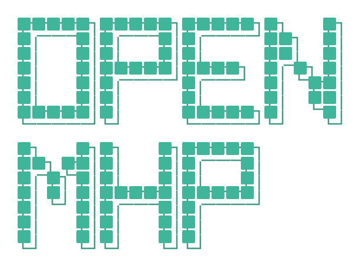
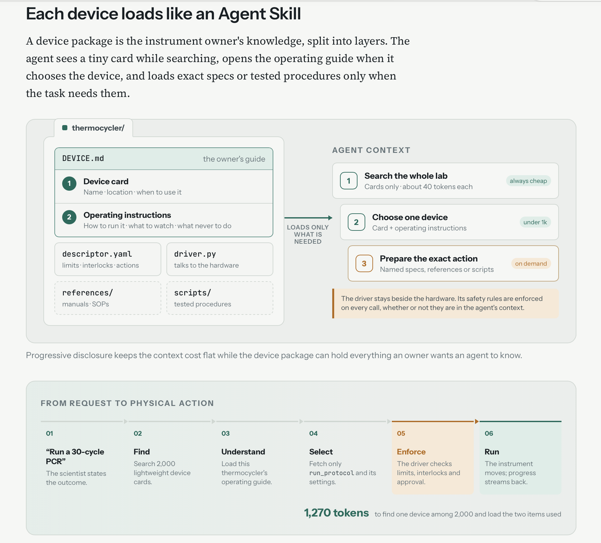

<div align="center">

<picture>
  <source media="(prefers-color-scheme: dark)" srcset="https://raw.githubusercontent.com/kushalsinha/openmhp/main/assets/hero-dark.svg">
  
</picture>

### Give AI agents a safe, shared interface to physical devices

OpenMHP is an open protocol for discovering, understanding, and operating lab instruments,
robots, and industrial equipment. MCP connects an agent to a software tool for a request and
response. OpenMHP extends that model for physical work that may run for minutes, hours, or days.

[](https://www.npmjs.com/package/openmhp-cli)
[](https://pypi.org/project/openmhp/)
[](https://github.com/kushalsinha/openmhp/blob/main/LICENSE)
[](https://openmhp.com)

[Quickstart](https://openmhp.com/quickstart) · [Experiment flow](https://openmhp.com/experiment-flow) · [Design](https://openmhp.com/design) · [Architecture](https://openmhp.com/architecture) · [Roadmap](https://openmhp.com/roadmap) · [Specification](https://github.com/kushalsinha/openmhp/blob/main/SPEC.md) · [Contributing](https://github.com/kushalsinha/openmhp/blob/main/CONTRIBUTING.md)

</div>

> **MCP calls a tool. OpenMHP stays with the machine.**
>
> An OpenMHP operation acquires a lease on the device, starts a durable job, and listens for
> telemetry, progress, results, and safety events until the work is complete. The agent can
> leave and return without losing the state of the physical process.

```text
MCP:      request ──────────────────────────────────────────────► response
OpenMHP:  lease ─► job ─► live telemetry and events ─► result ─► release
```


## Why OpenMHP?

Connecting an agent to a centrifuge, robot arm, microscope, or PLC is not an API call. The work
lasts hours, the instrument talks back while it runs, the know-how lives in manuals and
operators, a bad request can waste a sample, and every vendor is different. OpenMHP gives these
devices one agent-facing layer without replacing the control systems underneath:

- **Jobs for long-running work:** progress, results, and files survive the agent leaving.
- **Pushed observations:** signals, progress, and safety events come to the agent; no polling.
- **Progressive context:** a small card first, full instructions only for the device chosen.
- **Safety at the edge:** the server beside the instrument checks limits, interlocks, approvals,
  leases, and state before any vendor code runs.
- **Wrap what the lab has:** OPC UA, ROS 2, SiLA 2, MADSci, PyLabRobot, and MQTT stay in place.

An agent may propose an action; the device server decides whether it runs. OpenMHP complements
hardwired e-stops, PLC safety logic, and lab procedures; it does not replace them. More in the
[design principles](https://openmhp.com/design).

## Try it in five minutes

You need Node.js 18+ and Python 3.10+. Open Claude Code or Codex and ask:

```text
Install OpenMHP for me by running `npx openmhp-cli setup`, then tell me when it is ready.
```

Setup installs a runtime under `~/.openmhp`, the bundled Agent Skills, and the MCP server for
Claude Code and Codex. Any other MCP client takes
`{"mcpServers": {"openmhp": {"command": "npx", "args": ["-y", "openmhp-cli"]}}}`, and Python
users can `pip install "openmhp[all]"`. Then add two simulated instruments and ask for something
concrete:

```bash
npx openmhp-cli demo
```

```text
Find a thermocycler, show me its operating instructions, and rehearse a
3-cycle PCR at 95/58/72 °C before running it.
```

Ask for a 200 °C setpoint too: the driver refuses it and returns the allowed range. To update
later, run `npx -y openmhp-cli@latest update`; see [Updating](https://openmhp.com/quickstart#updating).

## What you can ask for

| You ask | OpenMHP does |
|---|---|
| “Find the instruments on my network.” | Scans mDNS and known hosts for OpenMHP devices and returns compact device cards. |
| “Onboard my hotplate.” | Interviews the owner, writes and validates a device package, and produces a safety card for review. |
| “Run a 30-cycle PCR and hold at 4 °C.” | Finds a compatible device or recipe, rehearses the procedure, runs it as a job, and reports measured results. |
| “Watch the incubator overnight.” | Runs a background monitor and stores readings and alerts with the run. |
| “Which GC method should I use for ethanol?” | Searches versioned methods associated with the device and project. |
| “Stop everything now.” | Requests e-stop for every device touched by the session. |
| “Get the lab to find GC conditions that separate ethanol from isopropanol, using my retention model and BO skill.” | Hands your request, model and optimizer to the lab gateway, relays its questions, reads you its plan, and once you approve, the gateway runs the closed loop and the results come home. |

## How it works

1. **Device package:** a card, operating instructions, a machine-readable descriptor,
   references, scripts, and a driver or adapter.
2. **Device server or lab node:** runs beside the instrument, translates calls into the native
   control API, publishes events, and enforces the device boundary.
3. **MCP bridge:** gives an agent one fixed set of tools whether the lab has two devices or two
   thousand.
4. **Gateway** (optional): for lab networks nothing outside may enter. Bench PCs dial out to it.

Adapters map OPC UA, ROS 2, SiLA 2, MADSci, PyLabRobot, and MQTT onto the same job, lease,
telemetry, and safety contract ([adapter guide](https://openmhp.com/adapters)). The
[architecture guide](https://openmhp.com/architecture) describes the components, and
[SPEC.md](https://github.com/kushalsinha/openmhp/blob/main/SPEC.md) is the normative protocol.

### Device packages

A device package works like an [Agent Skill](https://agentskills.io): the agent loads more
detail only as the task narrows, from a card while searching, to operating instructions once it
picks a device, to exact signals, actions, and tested scripts when it acts.



In the 2,000-device scale demo, finding five candidates, opening one, and loading what it needs
takes about 1,270 tokens instead of 1.22 million. The model's context helps it reason; it is not
the safety boundary. The driver checks every call, and only the device's owner can change a
package's limits.

## Supported devices

[`supported-devices`](https://github.com/kushalsinha/openmhp/tree/main/supported-devices) holds 81 ready-made packages, each with a driver, a
simulated twin, operating instructions, a setup note, and a self-assessed score against the
device-level criteria of Gottstein et al.'s autonomous-ready procurement profile. Full table:
[openmhp.com/instruments](https://openmhp.com/instruments).

| Field | Packages | Instruments |
|---|---|---|
| Pharma, small molecule | 16 | HPLC/UPLC under Empower, OpenLab CDS and Chromeleon; EasyMax/OptiMax reactor; Karl Fischer titrator; 708-DS dissolution; Rotavapor R-300; Crystal16; Vapourtec R-Series; DSC/TGA under TRIOS; Bruker NMR (ICON-NMR); D8 PXRD; Cary UV-Vis/FTIR; LyoStar freeze dryer; Mettler Toledo and Sartorius balances |
| Pharma, biologics | 14 | Biostat bioreactor; ÄKTA avant; CLARIOstar/PHERAstar, SpectraMax and Spark plate readers; Hamilton STAR; Vi-CELL BLU; Octet BLI; Zetasizer DLS; Maurice CE; QuantStudio qPCR; Cytek Aurora cytometer; Innova shaker; Heracell CO2 incubator; Sigma centrifuge; BINDER stability chamber |
| Materials, synthesis and processing | 8 | Eurotherm and Nabertherm furnaces; MBRAUN glovebox; Quantos powder dosing; Laurell and Ossila spin coaters; Retsch planetary mill; AJA/Lesker sputter tools |
| Materials, characterization | 9 | Rigaku SmartLab and Panalytical Empyrean XRD; Phenom, TESCAN and ZEISS SEM; Instron under Bluehill; Anton Paar rheometer; Quantum Design PPMS; Dektak profilometer |
| Energy storage | 3 | Neware and Arbin battery cyclers; Gamry potentiostat (EIS) |
| Chemistry | 13 | IKA C-MAG and EUROSTAR; JULABO circulators; BioLogic SP-300 and PalmSens potentiostats; Ocean Insight and Wasatch/Blaze spectrometers; SRI 8610C GC; Orbitrap (IAPI); LC-MS worklists for MassLynx, SCIEX OS, MassHunter, Xcalibur; Elveflow OB1 and MUX; FloPro sampler |
| Biology | 7 | Opentrons Flex and OT-2; Micro-Manager microscopes; New Era and Tecan Cavro syringe pumps; Atlas Scientific EZO sensors; benchtop centrifuge (operator-run) |
| Physics | 6 | Keithley 2400 SMU; Lake Shore 33x/350; Pfeiffer TPG gauges; SRS SR830 lock-in; SRS RGA; Thorlabs PM100D |
| Engineering | 5 | Alicat flow controllers; LabJack T-series; NI-DAQmx; Rigol DP8xx supply; Rigol DS1000Z scope |

## Connect a real instrument

On the PC wired to the instrument, name the package; `add` fetches it, asks only what a person
knows, checks the answers against the instrument, and keeps it running:

```bash
pip install "openmhp[node]"
mhp node add                       # lists the ready-made packages
mhp node add waters-empower-hplc
```

For anything not on the list, tell your agent *“Onboard my IKA hotplate. I have the manual.”*
Guides: [Add an instrument](https://openmhp.com/add-a-device), [Lab nodes](https://openmhp.com/lab-nodes).

### Instruments behind the lab firewall

The bench PC connects **outward** over HTTPS to a gateway on the company network; agents talk to
the gateway. No port is opened, and working from home over the VPN is the same as at your desk.


```bash
mhp gateway init && mhp gateway serve --install-service   # on the gateway, once
mhp node --join https://gw.office ab12-cd34                # on the lab PC, with a code from `mhp gateway pair`
mhp agent --join https://gw.office ef56-ab78               # on the agent machine, with a code from `mhp gateway pair-agent`
```


A request reaches the lab PC once or not at all, and the gateway is the approval boundary. More:
[Gateway and relay](https://openmhp.com/gateway).

### Experiments on the lab gateway

A scientist asks for an experiment in plain English, from their own agent, and hands over their own
models, optimizer and skills; the gateway plans it with them and, once they approve, runs the closed
loop on the lab's instruments.


The story, what it makes possible and how to set it up: [Experiment flow](https://openmhp.com/experiment-flow).
[`examples/gateway_closed_loop/`](https://github.com/kushalsinha/openmhp/tree/main/examples/gateway_closed_loop) runs it on one machine against a simulated chromatograph.

## Contributing

Contributions that make the protocol clearer, more interoperable, or better tested are welcome,
as are packages for instruments others also own. Open an issue before a substantial change.
[CONTRIBUTING.md](https://github.com/kushalsinha/openmhp/blob/main/CONTRIBUTING.md) has the development setup, the repository guide, and
pull-request expectations; the [roadmap](https://openmhp.com/roadmap) lists open work.

## Project status

OpenMHP is a pre-1.0 experimental protocol; expect breaking changes between minor versions.
Before real operation, have the instrument owner review `DEVICE.md`, verify limits and
interlocks against the manual, prove out-of-range requests are refused, test e-stop and
loss-of-contact behavior, and keep the manufacturer's safety systems in place. Supervise real
hardware deployments.

## License

Apache License 2.0. See [LICENSE](https://github.com/kushalsinha/openmhp/blob/main/LICENSE).

OpenMHP is an independent, community-driven project. It is not affiliated with, endorsed by,
or sponsored by Anthropic, the OPC Foundation, Open Robotics, the SiLA Consortium, MADSci,
PyLabRobot, or any instrument vendor. Names are used only to describe compatibility.
